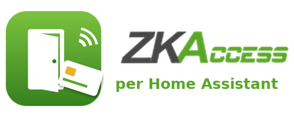

# ZKTeco Access

Controllo accessi ZKTeco C3/inBio direttamente da Home Assistant (sostituisce ZKAccess 3.5
sul PC): apertura porte, tessere RFID su una o più porte, livelli, fasce orarie, eventi in
tempo reale, import del database `zkaccess.mdb`, entità e automazioni via MQTT.

Vedi la scheda **Documentazione** per la guida completa.
